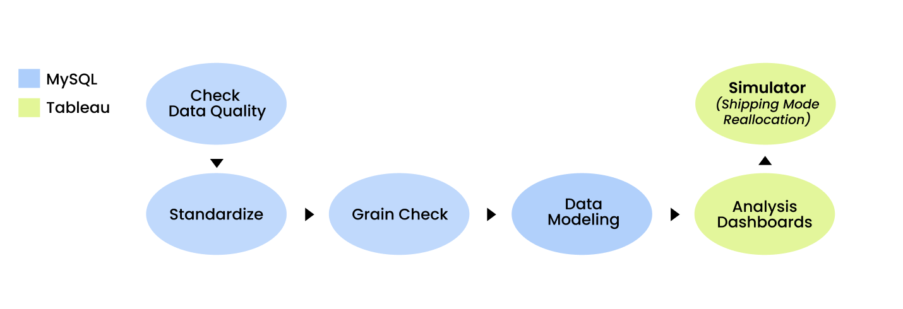

# DataCo Delivery Performance Analysis

**Công cụ:** MySQL, Tableau

Dự án phân tích hiệu quả giao hàng dựa trên dữ liệu DataCo Global, từ xử lý và mô hình hóa dữ liệu bằng DynamicSQL đến xây dựng dashboard và mô phỏng phương án cải thiện trên Tableau.

## demo

https://github.com/user-attachments/assets/9f75c1da-67e2-4f00-8f48-fa81c1274df1

 

## 1. Mục tiêu dự án

Dự án sử dụng bộ dữ liệu đánh giá hiệu quả giao hàng, tìm hiểu các yếu tố liên quan đến tỷ lệ giao trễ và đề xuất phương án cải thiện.

Phân tích tập trung vào 03 câu hỏi:  
(1) Tình trạng giao hàng trễ diễn ra như thế nào?  
(2) Phương thức vận chuyển đóng vai trò gì?  
(3) Việc điều chỉnh cơ cấu vận chuyển có thể cải thiện kết quả ra sao?  

 

## 2. Tổng quan dữ liệu

**Nguồn dữ liệu:** [DataCo Smart Supply Chain (Kaggle)](https://www.kaggle.com/datasets/shashwatwork/dataco-smart-supply-chain-for-big-data-analysis).

Bộ dữ liệu giả lập gồm **180.516 dòng và 53 cột**, ghi nhận hoạt động bán hàng và giao hàng với các thông tin về đơn hàng, sản phẩm, khách hàng, địa điểm và vận chuyển.

Mỗi dòng tương ứng với một sản phẩm trong đơn hàng, bao gồm tổng cộng **65.749 đơn hàng duy nhất**. Đặc điểm này đòi hỏi xác định đúng cấp độ dữ liệu trước khi tính toán và xây dựng dashboard.  

Mô hình dữ liệu sau khi được chuẩn hoá:

  

 

## 3. Quy trình triển khai

  

  <strong><em>Quy trình thực hiện dự án</em></strong>

 

Dự án được thực hiện qua 03 giai đoạn chính:  
(1) Data Cleaning: Kiểm tra chất lượng và chuẩn hóa dữ liệu.  
(2) Data Modeling: Xác định cấp độ dữ liệu, thiết kế mô hình hình sao gồm 05 bảng dữ liệu.  
(3) Dashboard & Analysis: Xây dựng 03 dashboard để đánh giá thực trạng giao hàng, phân tích vai trò của phương thức vận chuyển và mô phỏng hiệu quả của các phương án cải thiện.  

 

## 4. Tài liệu chi tiết

*[Data Modeling – Kiểm tra và mô hình hóa dữ liệu](data_modeling.md)*  
Trình bày quá trình kiểm tra chất lượng, chuẩn hóa dữ liệu và thiết kế mô hình hình sao bằng MySQL, tập trung vào các quyết định kỹ thuật và lý do lựa chọn mô hình.

*[Dashboard Insights – Phân tích và mô phỏng](dashboard_insights.md)*  
Giới thiệu thiết kế 03 dashboard trên Tableau, các phát hiện chính về hiệu quả giao hàng, đề xuất cải thiện và cách sử dụng công cụ mô phỏng để đánh giá các phương án phân bổ vận chuyển.

 

## 5. Hạn chế

Phân tích tập trung vào vai trò của phương thức vận chuyển đối với tỷ lệ giao trễ, chưa xem xét đầy đủ các yếu tố khác như khoảng cách, chi phí và điều kiện vận hành.

Công cụ mô phỏng sử dụng hiệu quả giao hàng trong quá khứ để ước tính tác động khi thay đổi cơ cấu phân bổ, vì vậy kết quả chỉ mang tính tham khảo trước khi triển khai thực tế.
