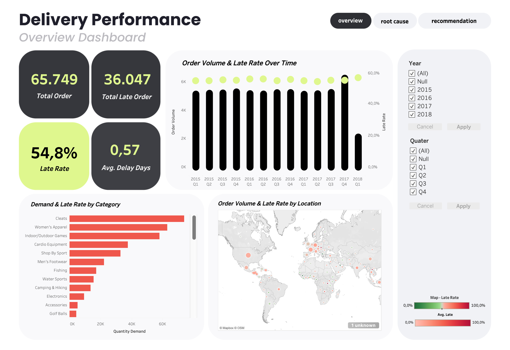

# Phân tích hiệu quả giao hàng và đề xuất cải thiện

Tài liệu trình bày cách xây dựng 3 dashboard trên Tableau, những kết quả phân tích chính và các phương án cải thiện được mô phỏng từ dữ liệu DataCo.

## 1. Mục tiêu phân tích

Dựa trên dữ liệu DataCo Global đã được chuẩn hoá, hệ thống dashboard được xây dựng nhằm đánh giá hiệu quả giao hàng, xác định những yếu tố liên quan đến tỷ lệ giao hàng trễ và đề xuất phương án cải thiện.

03 dashboard được xây dựng theo trình tự:

1. Đánh giá thực trạng giao hàng.
2. Phân tích vai trò của phương thức vận chuyển.
3. Mô phỏng các phương án phân bổ lại đơn hàng theo phương thức vận chuyển.

Mục tiêu cuối cùng là hỗ trợ bộ phận vận hành xác định vấn đề và cân nhắc các phương án cải thiện hiệu quả giao hàng.

## 2. Thiết kế dashboard

### 2.1. KPI

KPIs được tính ở cấp độ đơn hàng (`order_id`) nhằm tránh trùng lặp do một đơn hàng có thể chứa nhiều sản phẩm.

| KPI | Định nghĩa |
|---|---|
| Total Orders | Tổng số đơn hàng |
| Late Orders | Số đơn hàng được ghi nhận giao trễ |
| Late Rate | Tỷ lệ đơn hàng giao trễ trên tổng số đơn hàng |
| Avg. Delay Days | Số ngày giao trễ trung bình |
| Avg. Scheduled Shipping Days | Thời gian vận chuyển dự kiến trung bình |
| Avg. Actual Shipping Days | Thời gian vận chuyển thực tế trung bình |

### 2.2. Dashboards & Insights

#### 2.2.1. Overview – Tổng quan hiệu quả giao hàng

Dashboard đầu tiên đánh giá thực trạng giao hàng thông qua các chỉ số tổng quan và ba góc độ phân tích: thời gian, nhóm sản phẩm và địa điểm giao hàng.

<!-- CHÈN ẢNH OVERVIEW TẠI ĐÂY; thay overview.png bằng tên ảnh thật trong resources/assets.

<em>Hình 1. Tổng quan hiệu quả giao hàng</em>

-->

**Kết quả phân tích**

Trong tổng số **65.749 đơn hàng**, có **36.047 đơn giao trễ**, tương đương **54,8%**. Tỷ lệ này duy trì tương đối ổn định qua các quý, nhóm sản phẩm và địa điểm giao hàng, dù số lượng đơn hàng giữa các nhóm có sự khác biệt.

Kết quả cho thấy tình trạng giao hàng trễ không tập trung vào một thời điểm, nhóm sản phẩm hay khu vực cụ thể. Điều này gợi ý rằng tỷ lệ giao trễ cao có thể liên quan đến những yếu tố vận hành chung, thay vì chỉ xuất phát từ đặc điểm riêng của từng nhóm đơn hàng.

#### 2.2.2. Root Cause – Phân tích vai trò của phương thức vận chuyển

Dashboard thứ hai tập trung phân tích hiệu quả giao hàng của từng phương thức vận chuyển (Shipping Mode) và cơ cấu phân bổ các phương thức này theo độ phức tạp đơn hàng, nhóm sản phẩm và điểm đến của đơn hàng.

<!-- CHÈN ẢNH ROOT CAUSE TẠI ĐÂY; thay root_cause.png bằng tên ảnh thật.

<em>Hình 2. Phân tích vai trò của phương thức vận chuyển</em>

-->

**Kết quả phân tích**

Tỷ lệ giao trễ có sự khác biệt lớn giữa các phương thức vận chuyển. **First Class** và **Second Class** có tỷ lệ giao trễ lần lượt là **95,3%** và **76,7%**, trong khi **Same Day** và **Standard Class** thấp hơn, ở mức **46,1%** và **38,1%**.

Mặc dù Standard Class chiếm phần lớn số đơn hàng và có tỷ lệ giao trễ thấp nhất, hiệu quả của phương thức này vẫn không đủ để bù đắp tỷ lệ giao trễ cao từ các phương thức còn lại, đặc biệt là First Class và Second Class.

Bên cạnh đó, cơ cấu phân bổ Shipping Mode tương đối đồng đều giữa các nhóm đơn hàng, bất kể độ phức tạp, nhóm sản phẩm hay quốc gia giao hàng.

Kết quả này giúp giải thích vì sao tỷ lệ giao trễ chung duy trì ở mức cao và ít biến động giữa các nhóm dữ liệu, đồng thời cho thấy việc điều chỉnh cơ cấu phân bổ phương thức vận chuyển là một hướng cải thiện đáng xem xét.

#### 2.2.3. Simulation – Mô phỏng kết quả của các phương án cải thiện

Dashboard cuối cùng được xây dựng để đánh giá các kịch bản điều chỉnh phân bổ phương thức vận chuyển dựa trên dữ liệu lịch sử.

<!-- CHÈN ẢNH SIMULATION TẠI ĐÂY; thay simulation.png bằng tên ảnh thật.

<em>Hình 3. Mô phỏng các phương án cải thiện</em>

-->

Người dùng có thể thay đổi **03 yếu tố**:

- **Thời gian tham chiếu:** Lựa chọn năm và quý để sử dụng dữ liệu lịch sử tương ứng.
- **Phạm vi áp dụng:** Ưu tiên các nhóm sản phẩm hoặc địa điểm, đồng thời điều chỉnh số nhóm được lựa chọn.
- **Cơ cấu vận chuyển:** Thay đổi tỷ trọng phân bổ giữa bốn phương thức vận chuyển.

Kết quả mô phỏng mang tính tham khảo, dựa trên giả định hiệu quả giao hàng lịch sử của từng phương thức không thay đổi khi điều chỉnh phân bổ.

**Ý nghĩa ứng dụng**

Công cụ cho phép bộ phận vận hành thử nghiệm nhiều phương án trước khi triển khai, đồng thời đánh giá:

- Phạm vi nào nên được ưu tiên điều chỉnh.
- Cơ cấu vận chuyển nào có khả năng giảm tỷ lệ giao trễ.
- Mức cải thiện dự kiến khi áp dụng phương án cho các nhóm đơn hàng khác nhau.

Các kịch bản có thể được so sánh để lựa chọn phương án phù hợp với mục tiêu vận hành và nguồn lực thực tế.

**Kết quả phân tích**

Qua các kịch bản thử nghiệm, việc ưu tiên điều chỉnh theo nhóm sản phẩm và giảm tỷ trọng First Class, Second Class để chuyển sang Same Day, Standard Class cho thấy tiềm năng giảm tỷ lệ giao trễ.

## 3. Đề xuất cải thiện

Từ kết quả phân tích, việc điều chỉnh cơ cấu phân bổ phương thức vận chuyển là một hướng cải thiện đáng xem xét, thay vì chỉ tập trung vào từng nhóm sản phẩm hoặc khu vực giao hàng.

**02 hướng đề xuất chính:**

1. **Điều chỉnh cơ cấu phương thức vận chuyển:** Cân nhắc giảm tỷ trọng First Class và Second Class, đồng thời chuyển một phần đơn hàng sang Same Day và Standard Class, là hai phương thức có tỷ lệ giao trễ thấp hơn trong dữ liệu lịch sử.
2. **Ưu tiên triển khai theo nhóm đơn hàng:** Thay vì điều chỉnh đồng loạt, có thể sử dụng dashboard mô phỏng để xác định các nhóm sản phẩm hoặc địa điểm có tiềm năng cải thiện lớn, từ đó lựa chọn phạm vi triển khai phù hợp.

## 4. Hạn chế phân tích

Một số giới hạn cần lưu ý:

- Phân tích tập trung vào cơ cấu phân bổ phương thức vận chuyển, chưa xem xét đầy đủ các yếu tố khác có thể ảnh hưởng đến hiệu quả giao hàng, như khoảng cách vận chuyển hoặc điều kiện logistics.
- Phân tích chưa xét đến chi phí vận chuyển, năng lực đáp ứng và các ràng buộc vận hành thực tế.
- Mô phỏng giả định tỷ lệ giao trễ lịch sử của mỗi phương thức không thay đổi khi điều chỉnh phân bổ đơn hàng. Vì vậy, kết quả mô phỏng chỉ đóng vai trò hỗ trợ đánh giá phương án, không phải dự báo chắc chắn về hiệu quả khi triển khai.
